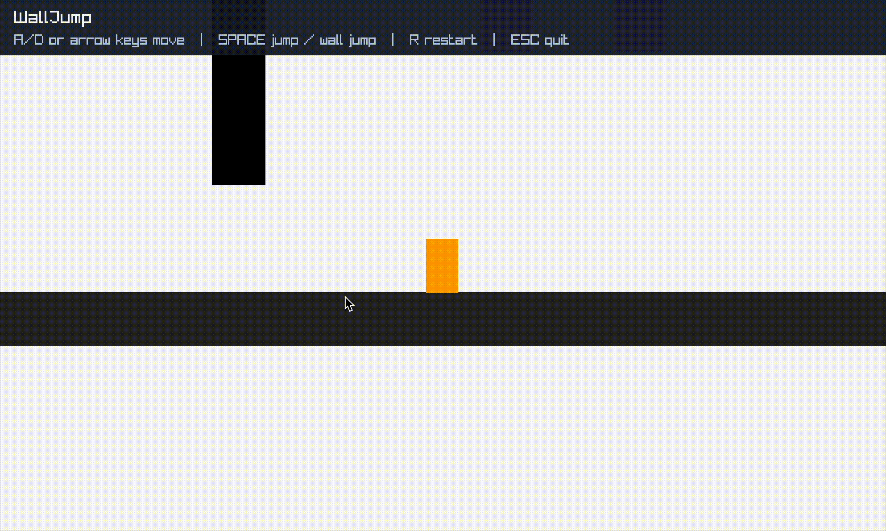

# DLEngine

A personal 2D game engine written in **C++20**, with a component-based scene hierarchy and custom physics. [Raylib](https://www.raylib.com/) handles windowing, drawing, input, and audio.



## Features

- Game objects and components with parent–child transforms and lifecycle callbacks.
- Fixed-step simulation, circle and axis-aligned rectangle collision detection, collision layers, friction, and restitution.
- Layered rendering, primitive shapes, sprites, tiled sprites, and a 2D camera.
- Typed events, target filtering, script timers, and configurable input axes.
- Audio playback and texture management.

## Demos

Both demos use built-in rectangle rendering and require **no image, audio, or other asset files**.

| Demo | Description | Controls |
| --- | --- | --- |
| **WallJump** | A platforming playground with wall jumps, ledges, and narrow climbing passages. | A/D or arrow keys to move; Space to jump or wall-jump. |
| **Flap Bird** | Guide a flying rectangle through gaps between pillars. | Space to flap. |

Press **R** to restart either demo and **Esc** to quit. A standalone macOS Apple Silicon build of WallJump is provided with the GitHub release.

## Build

Requires **CMake 3.24+**, a **C++20 compiler**, and an internet connection for the first configure. CMake downloads and builds the pinned [Raylib 5.5](https://github.com/raysan5/raylib/releases/tag/5.5) dependency automatically; no separate Raylib installation is needed.

```sh
cmake -S . -B build -DCMAKE_BUILD_TYPE=Release
cmake --build build --config Release --parallel
```

On macOS, install the Xcode Command Line Tools and CMake, then open `build/WallJump.app` or `build/FlapBird.app` (with the default Makefiles/Ninja generator). On Windows, use a C++20-capable Visual Studio toolchain; executables are typically under `build/Release/`. On Linux, install the [Raylib desktop development prerequisites](https://github.com/raysan5/raylib/wiki/Working-on-GNU-Linux) before building, then run `build/WallJump` or `build/FlapBird`.

Builds and demos have been checked on **macOS / Apple Silicon**. No particular working directory is required when launching them.

## Codebase

| Directory | Contents |
| --- | --- |
| `DLCore/` | Engine loop, entity/event/physics managers, math, input, timers, audio, and textures. |
| `GameObject/` | Scene hierarchy, transforms, component ownership, and lifecycle. |
| `Components/` | Scripts, shapes, physics bodies, and drawing components. |
| `Components/Tests/WallJump/` | WallJump scene and player controller. |
| `Components/Tests/Flap Bird/` | Flap Bird scene, player, and pillar spawning. |

`main.cpp` initializes the engine and runs the demo selected by its CMake target.
